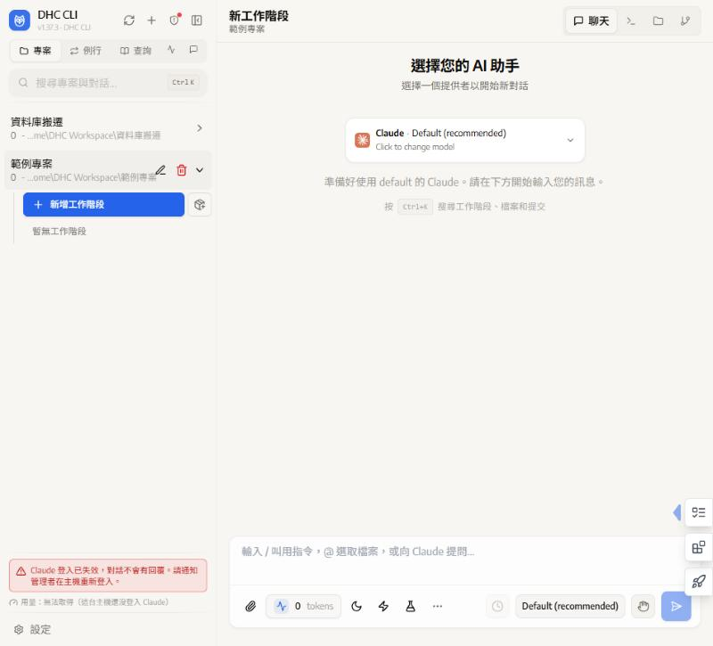
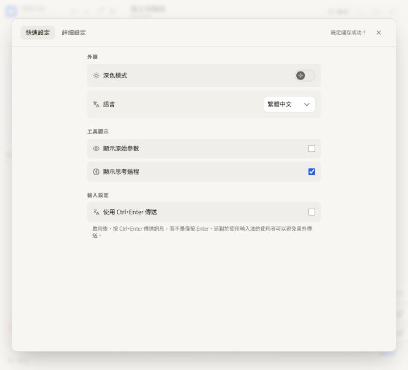
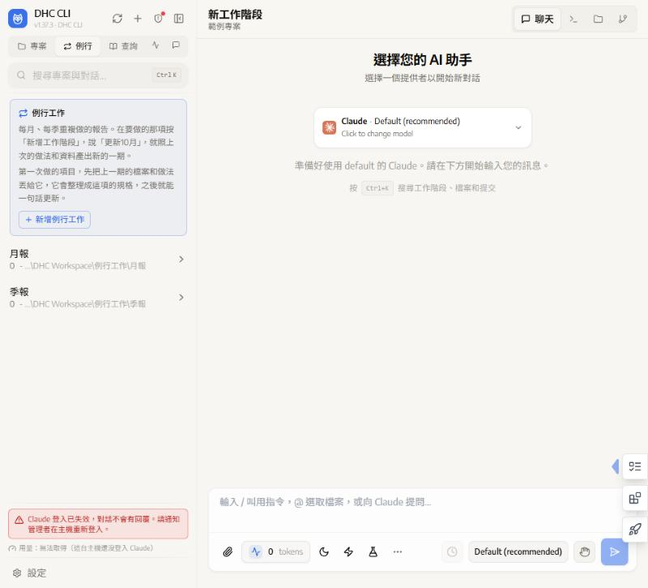
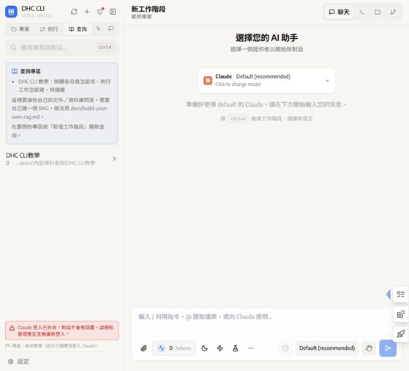
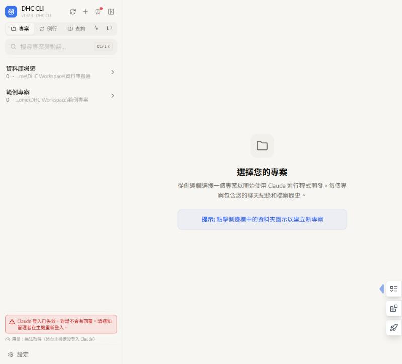
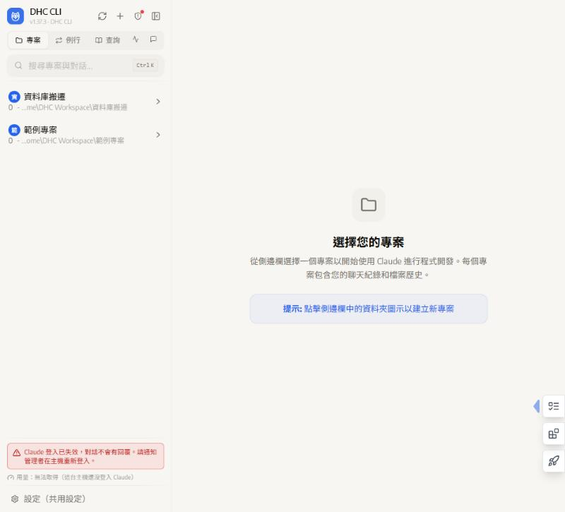

<div align="center">
  
  <h1>DHC CLI</h1>
  <p>在瀏覽器裡使用 Claude Code、Codex 等 AI Agent 的工作台：專案、例行報告、問答專區、待辦、白板，一個畫面管完。</p>
</div>

> **DHC CLI 是 [CloudCLI](https://github.com/siteboon/claudecodeui)（siteboon/claudecodeui，v1.37.3）的 fork。** 授權沿用 AGPL-3.0-or-later，上游的著作權與署名保留在 [LICENSE](LICENSE)、[NOTICE](NOTICE) 與 git 歷史；上游原本的說明在 [docs/cloudcli-README.md](docs/cloudcli-README.md)。

> [!TIP]
> **第一次用：把 [SETUP_PROMPT.md](SETUP_PROMPT.md) 整份貼給你的 AI Agent（Claude Code、Codex…）。** 它會問你四個問題（個人或團隊、要不要遠端、用哪款 Agent、用途），幫你改好 `dhc.config.json` 並驗證。

## 截圖

| 專案分頁與聊天 | 設定 |
|---|---|
|  |  |
| **例行分頁** | **查詢分頁** |
|  |  |
| **個人模式（personal）** | **團隊模式（team）** |
|  |  |

## 快速開始

需要：

- **Node.js 22 以上**（含 npm）與 git
- **自行安裝並登入 Claude Code**（本 repo 不附 Claude Code 執行檔）：照 [官方說明](https://docs.anthropic.com/en/docs/claude-code) 安裝後，在終端機執行一次 `claude` 完成登入。要用 Codex 就另外安裝並登入 Codex CLI。

```bash
git clone <這個 repo 的網址>
```

```bash
cd dhc-cli
```

```bash
npm ci
```

```bash
npm run build
```

```bash
npm run server
```

打開 <http://127.0.0.1:3001>，第一次會要你建立登入帳號。伺服器預設只聽本機（`127.0.0.1`），要換 port 或開放區網，複製 `.env.example` 成 `.env` 修改 `SERVER_PORT`、`HOST`（開放前先設好登入）。

第一次啟動會在家目錄建立工作區 `DHC Workspace`（已存在的檔案不會被覆蓋），並註冊「DHC CLI 教學」問答專區。工作區位置與其他選項見 [docs/dhc-config.md](docs/dhc-config.md)。

開發模式（前端熱更新）：`npm run dev`。

## 設定：dhc.config.json

```json
{
  "workspaceRoot": "DHC Workspace",
  "mode": "personal",
  "remote": { "enabled": false },
  "agents": ["claude", "codex"],
  "domain": "general"
}
```

- `mode`：`personal` 先把團隊功能（設定檔、Co-Work 邀請、頭像、多人待辦）藏起來；`team` 全開。
- `agents`：畫面上要出現哪些 AI Agent。
- `remote`：要從外網連回來才需要，做法見 [modules/remote](modules/remote/README.md)。
- `domain`：用途。`finance` 會用到 [domains/finance](domains/finance) 的金融作業檢核 skill；其他用途見 [domains/README.md](domains/README.md)。

完整說明：[docs/dhc-config.md](docs/dhc-config.md)。

## 和上游 CloudCLI 的差異

- **側欄分頁**：專案（只列工作區根目錄底下的資料夾）、例行（每月／每季重複的報告）、查詢（問答專區）、執行中（含子代理）。
- **對話**：⚡ 快閃任務（到期自動清掉）、燒杯「蒸餾模式」（把你的判斷整理成技能草稿）、月亮「夜間排程」（排隊到晚上依序執行）、收納盒、對話跳轉拉桿、時間戳與跨日分隔、圖片標註、自動取名。
- **待辦**：右側把手的今日待辦與重要／緊急四格矩陣。
- **工具庫**：文件共編、試算工作台、簡報工作室、程式差異審閱台、白板（系統規劃、SOP 泳道、心智圖、資料流程，可直接叫 AI 開工）、許願池。
- **團隊功能**（`mode: team`）：每台裝置的設定檔、Co-Work 共享對話與邀請、頭像。
- **側欄用量**：Claude 訂閱的 5 小時與每週用量、登入到期提醒（伺服器讀本機 Claude Code 的登入，token 不會送到瀏覽器）。
- **模組化設定**：`dhc.config.json`、`/api/dhc/config`、`modules/remote`（Cloudflare 通道與登入閘門範本）、`domains/`（用途包）。
- **安全預設**：伺服器預設只綁 `127.0.0.1`。
- **其他**：版本更新視窗、警示鈴、繁體中文介面調整。

## 授權

AGPL-3.0-or-later，見 [LICENSE](LICENSE)。本專案改自 [siteboon/claudecodeui](https://github.com/siteboon/claudecodeui)，上游著作權歸原作者所有，見 [NOTICE](NOTICE)。依 AGPL，若你把修改後的版本提供給他人透過網路使用，也要提供對應的原始碼。

本 repo 不散布 Claude Code 執行檔或任何第三方 skill／plugin 原始碼；`domains/` 裡的 skill 是本專案自己寫的通用內容。

---

## English summary

DHC CLI is a fork of [CloudCLI](https://github.com/siteboon/claudecodeui) v1.37.3 (AGPL-3.0-or-later): a browser workbench for Claude Code, Codex and other AI agents, with project / routine-report / Q&A tabs, to-dos, a whiteboard, night-time queueing and usage meters. Behaviour is switched by `dhc.config.json` (`personal`/`team` mode, enabled agents, optional remote access, domain packs).

Quick start: install Node.js 22+ and Claude Code yourself (log in once with `claude`), then `npm ci`, `npm run build`, `npm run server`, and open <http://127.0.0.1:3001>. To configure it with your own agent, paste [SETUP_PROMPT.md](SETUP_PROMPT.md) into it.
